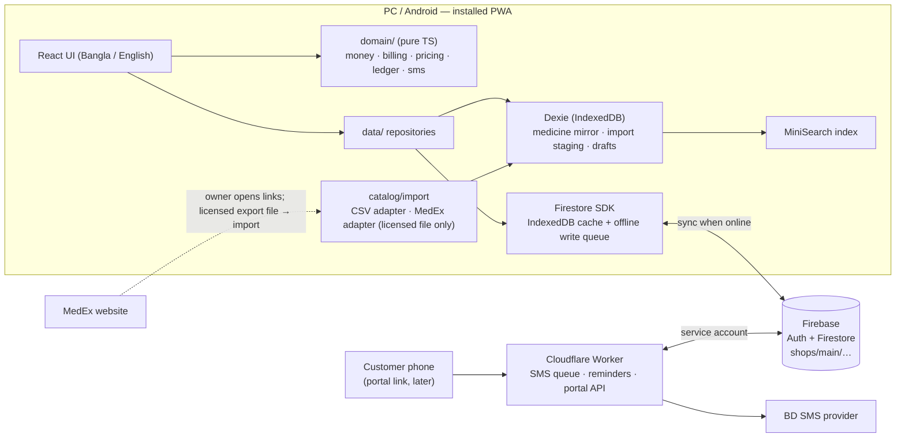

# Architecture — MediBooks (pharmacy due book)

Status: **Approved by the owner on 2026-10-22** (go-ahead to build). Phase 1 done. Open decisions: see the end of this file.
Shop: M/S ALLOPATHIC STORE & SURGICAL, R.K Mission Road, Sreemangal, 01711460114.
Main purpose: customer due (বাকি) management. Private, non-commercial software.

This document replaces the earlier medicine plan (Kaggle CSV as the medicine database). Kaggle is **not used**.

---

## 0. MedEx findings (checked 2026-10-22)

What was checked: `robots.txt`, Terms of Use, Disclaimer, Downloads page, App page, and one brand page, by normal browser-style requests (no login, no automation beyond reading those pages).

| Question | Finding |
|---|---|
| Official public API? | **None found.** No API docs, no developer page. Their mobile app ("MedEx Plus") talks to private endpoints; we do not use them. |
| Data export / download? | **None for medicines.** The Downloads page has only PDFs (drug acts, formularies, policy documents). |
| robots.txt | `User-agent: * / Disallow:` (technically allows crawling). |
| Terms of Use | §1: view/print/download for **personal, non-commercial use only**; reproduction or distribution without approval prohibited. §2: **extracting data with bots, crawlers or any software without express written consent is prohibited.** |
| CAPTCHA / login on brand pages | None seen. |
| Brand page content | Server-rendered HTML, no structured data. Shows brand, dosage form, generic, strength, manufacturer, unit price, pack (e.g. `2 x 10: ৳ 640.00`), strip price. |

**Conclusion:** robots.txt does not override the Terms of Use. Automated scraping of MedEx is **not appropriate** without written permission. The Kaggle dataset is itself a MedEx scrape, so it has the same problem (and is stale).

**Owner-supplied file (2026-10-22):** `MedEx_Medicine_Directory.xlsx` — generated by a Python script (openpyxl) minutes before it was shared; sheets mirror MedEx's site sections (25,576 allopathic + 930 herbal brands, generics, companies), every row carries a MedEx ID and page link; **no prices, no pack sizes**. It looks like an automated extraction of MedEx, not an official export, so it is **not imported** until the owner confirms written permission from MedEx.
**Update (2026-10-22):** the owner stated that they **have MedEx's written permission** to use this list in the shop's app. The file is therefore imported as a **reference list** (§3.1 `refCatalog`); every upload records the owner's confirmation (`permissionConfirmed` + audit log). Keep a copy of the permission letter with the shop's papers. We still never crawl MedEx or call its endpoints — only this owner-supplied file is used.
**Price file (2026-10-22):** the owner then supplied `medex_medicines_partial.csv` (MedEx brand rows with prices: 3,392 brands, all on the list; 3,389 priced — about 13% of the list, so partial) and asked to load the prices under the same permission. It is imported in-app as the **MedEx দামের ফাইল** (§6); the upload records the owner's permission tick like the list. A full price file is imported the same way when the owner has it.

So MedEx is treated as a **human reference** (the owner can open a medicine's MedEx page from the app via a saved link) and as a **licensed import source only if MedEx gives written permission or an export file**. The importer is built so that any legitimate file plugs in without changing the rest of the app.

Other legitimate sources the importer supports:
- Supplier/company price lists and purchase invoices the shop already receives (CSV typed or exported by the owner).
- Manual entry from the medicine box (MRP) at the counter.
- (Later, optional) The DGDA registered-drug registry that DGHS publishes as a FHIR code system (~39k products, names/strength/form/manufacturer, **no prices**). Licence/terms to be confirmed before use.

---

## 1. Recommended architecture

Keep the stack already chosen in `CLAUDE.md`, with one addition (Dexie for the local medicine store). No custom backend server.

| Layer | Choice | Why |
|---|---|---|
| App | Vite + React 18 + TypeScript (strict) + Tailwind, installed as a **PWA** on PC and Android | One codebase for PC + mobile; works offline; free hosting |
| Business logic | Plain TypeScript in `web/src/domain/` (no React, no Firebase) | Money and ledger rules are unit-tested in isolation |
| Sync database | **Firebase Firestore** (Spark free plan) with `persistentLocalCache` (IndexedDB) | Built-in offline write queue + multi-device sync; no server to run |
| Auth | Firebase Auth, email/password, one owner | Simple; ready for staff accounts later |
| Local store | **Dexie (IndexedDB)** for the medicine catalog mirror, import staging, drafts, usage counts | Fast offline search over medicines without re-reading Firestore; Firestore's own cache is not searchable |
| Search | MiniSearch (prefix + fuzzy) built from the Dexie medicine table | < 100 ms on a low-end phone |
| Server jobs | **Cloudflare Worker** (free) | SMS sending (API key stays secret), reminder cron, later the customer portal API. Firebase Functions would force the paid Blaze plan |
| Hosting | Firebase Hosting | Free, HTTPS, same project |



**Hard rules**
1. The app never calls MedEx (or any medicine source) during a sale. Sales read only the local medicine store.
2. Every sale line stores a full **snapshot**; old transactions are never recalculated from master data.
3. Money is integer **paisa** everywhere.
4. Customer balance changes only via `increment()` in the same batch as the transaction that causes it.
5. Nothing financial is hard-deleted one by one (void + reversal + audit log). The only exception, at the owner's request (2026-10-27): deleting a whole customer with all their transactions (owner only, typed confirmation, audit summary kept).

---

## 2. Folder structure

```
pharmacy-baki/
  CLAUDE.md                     # rules for Claude (short; points here)
  docs/
    ARCHITECTURE.md             # this file (source of truth for design)
    SPEC.md                     # screens and behaviour
    PROMPTS.md                  # phase-by-phase build prompts
  data/
    imports/                    # owner's import files (gitignored): supplier lists, licensed exports
  scripts/                      # optional Node helpers (e.g. big-file import dry run)
  web/                          # the PWA
    src/
      app/                      # shell, routes, layout, providers
      domain/                   # PURE logic, 100% unit-tested, no imports from React/Firebase
        types.ts                #   entity types (mirror of §3)
        money.ts                #   paisa parse/format, percent (basis points), rounding
        billing.ts              #   buildSale(), buildPayment(), buildOpening(), buildVoid()
        pricing.ts              #   sellable units (piece/strip/pack/custom), effective price
        ledger.ts               #   running balance, balance check
        phone.ts, sms.ts, dates.ts, ids.ts
      data/
        firebase.ts             #   init, persistent cache, emulator switch
        paths.ts                #   every Firestore path in one place (shops/{shopId}/…)
        localdb.ts              #   Dexie schema + migrations
        repos/                  #   customers, transactions, medicines, settings, smsQueue, audit
      catalog/                  # medicine master-data
        sync.ts                 #   Firestore → Dexie delta sync
        search.ts               #   MiniSearch index + usage ranking
        import/
          pipeline.ts           #   normalize → validate → match → diff → apply
          normalize.ts          #   "2 x 10" → strip 10 / pack 20, "Tab." → "Tablet", price text → paisa
          adapters/
            types.ts            #   SourceAdapter + SourceRecord interfaces
            csv.ts              #   generic CSV (template we publish)
            medex.ts            #   stub; written only against a real licensed sample
      features/                 # screens: dashboard, customers, sale, payment, ledger, reminders,
                                #          reports, medicines, imports, sms-log, settings
      components/  stores/  i18n/
  worker/                       # Cloudflare Worker: /sms/*, cron, /portal/* (later)
  firebase.json  firestore.rules  firestore.indexes.json  .firebaserc
```

Dependency direction: `features → stores/catalog → data → domain`. `domain` imports nothing from the app.

---

## 3. Database / schema structure

### 3.1 Firestore (synced; everything under `shops/{shopId}/`, v1 `shopId = "main"`)

Every document has `schemaVersion: 1`, `createdAt`, `createdBy` (uid), and where editable `updatedAt` (serverTimestamp).

**`settings/general`** — shop info, SMS, reminder, billing, UI settings (unchanged from SPEC §8, §9, §12).

**`customers/{mobile}`** — doc id = normalized mobile `01XXXXXXXXX` (natural de-duplication offline)
```
mobile, name, address, note,
totalDuePaisa            // increment-only
smsEnabled, reminderEnabled, archived,
lastTxnAt, lastPaymentAt, lastReminderAt, reminderMonth, reminderCountThisMonth
```

**`transactions/{autoId}`** — append-only; amounts never edited
```
customerId, customerName            // name snapshot for memos
type: 'sale' | 'payment' | 'opening' | 'adjustment'
memoNo                              // 'B-YYMMDD-XXXX', random suffix (offline-safe)
mode: 'items' | 'amount' | null     // sale only
lines: SaleLine[]                   // sale + items only (see below)
subtotalPaisa
billDiscount: { type: 'none' | 'percent' | 'flat', value }   // percent in basis points (12.5% = 1250)
billDiscountPaisa, roundOffPaisa, netPaisa
paidNowPaisa, paymentMethod: 'cash' | 'card' | 'bkash' | 'nagad' | null, trxId
effectPaisa                         // signed change to totalDuePaisa
memoPrevDuePaisa                    // what the memo showed as "আগের বাকি" (display only, not authoritative)
note, deviceId, serverAt
voided, voidedAt, voidedBy, voidReason
```

**SaleLine (snapshot — copied at sale time, never re-read from master)**
```
lineNo
medicineId: string | null           // link only; null for free-text items
name, genericName, strength, dosageForm, manufacturer
unit: 'piece' | 'strip' | 'pack' | 'custom'
unitLabel: string | null           // custom unit text only ("১ রোল"); null for piece/strip/pack (label shown from unit + piecesPerUnit in the current language)
piecesPerUnit: number | null        // 1, strip size, pack size, or null for custom
qty                                 // positive integer
listUnitPricePaisa: number | null   // master price for this unit at sale time (audit)
unitPricePaisa                      // price actually charged per unit
priceOverridden: boolean
discountPaisa                       // line discount, default 0
lineTotalPaisa                      // qty × unitPricePaisa − discountPaisa
```

**`medicines/{autoId}`** — the shop's own medicine master (only medicines the shop sells; hundreds to a few thousand)
```
brandName, genericName, strength, dosageForm, manufacturer
dosageText                          // form/dosage text exactly as the source wrote it
packDescription                     // e.g. "10 x 10", "100 ml bottle"
piecesPerStrip: number | null
piecesPerPack: number | null
// prices per sellable unit, two layers
sourceUnitPricePaisa, sourceStripPricePaisa, sourcePackPricePaisa   // from the last import/source (nullable)
shopUnitPricePaisa,   shopStripPricePaisa,   shopPackPricePaisa     // owner overrides (nullable) — imports never touch these
// provenance
sourceName: 'manual' | 'csv' | 'medex' | 'dgda'
sourceId: string | null             // e.g. MedEx brand id
sourceUrl: string | null            // link the owner can open
sourceUpdatedAt: Timestamp | null   // date the source says the data is from
sourceFetchedAt: Timestamp | null   // when we imported it
lastImportId: string | null
sourceStatus: 'listed' | 'missing'  // 'missing' = not in the latest import file (flag only)
status: 'active' | 'inactive'       // owner-controlled; never deleted
updatedAt                           // serverTimestamp = "local updated date", drives delta sync
```

**`medicinePriceHistory/{autoId}`** — create-only log: `medicineId, field, oldPaisa, newPaisa, reason: 'import' | 'manual', importId, at, by`

**`medicineImports/{autoId}`** — one summary per import: `sourceName, fileName, fileSha256, sourceDate, counts {new, changed, unchanged, missing, skipped, errors}, status, startedAt, appliedAt, by`. Raw rows are **not** stored in Firestore.

**`smsQueue/{autoId}`** — `kind` (bakiAdd · payment · paymentClear · reminder · opening · test), `customerId` (null only for the owner's test message), `customerName`, `to` (01XXXXXXXXX), `text` (rendered on the device, ≤ 640 chars), `segments`, `unicode`, `txnId`, `status` (pending → sending → sent / failed / test), `attempts`, `lastError`, `providerRef`, `retryAt`, `claimedAt`, `sentAt`, `finishedAt`, `createdAt` (device time) + `serverAt`, `createdBy` (uid, or `worker` for the daily reminders), `auto` (Worker reminders). The app only creates `pending` items (and the owner may set a `failed` one back to `pending`); everything else is the Worker's.
**`auditLog/{autoId}`** (create-only) — as in CLAUDE.md.

**`refCatalog/medex`** + **`refCatalog/medex/chunks/{version}-{n}`** — the MedEx reference list (26,506 brands; prices for the brands in the price file), packed into ~4 documents: a dictionary chunk (forms, generics, companies) and row chunks of < 700 KB (`[id, brand, formIdx, strength, genericIdx, companyIdx, slug, herbal]`, plus `unitPaisa, packPaisa, packText, priceText` on priced rows only). The meta doc holds `version` (file SHA-256 prefix; after a price import, a hash of the previous version + the price file), file name/date, counts, `importedAt/By`, `permissionConfirmed`, `priceFile {fileName, fileSha256, rows, importedAt}`, `pricedCount`. A new brand list keeps the prices already on the list (by MedEx id). Uploaded in one batch (atomic); old-version chunks are deleted in the same batch. Never one document per row (free-tier quota).

**`prescriptions/{autoId}`** (Phase 13) — one prescription photo on a customer: `customerId` (mobile), `takenAt`, `note` (≤ 200), `thumb` (Firestore `bytes`, small JPEG ≈ 240 px for the gallery), `width`, `height`, `imageBytes`, `createdAt/By`, `deviceId`, `schemaVersion`. Listed per customer (`customerId ==`, `createdAt desc`; composite index). Moves with the customer on change-mobile (`customerId`-only update).
**`prescriptionImages/{same id}`** — the photo itself: `image` (`bytes`, JPEG shrunk in the browser to ≤ ~1400 px and < 700 KB so it fits one document), `createdAt/By`, `schemaVersion`. Kept apart so the gallery never downloads full photos. Create + delete only.
**`stats/usage`** — `prescriptionCount`, `prescriptionBytes`, changed only by `increment()` in the same batch as an add/delete, so Settings can show how much of the free 1 GiB the photos use with one read.
Why Firestore and not Cloud Storage: since late 2024 a new Cloud Storage bucket needs the paid Blaze plan; the shop stays on Spark (no card). Firestore's free 1 GiB holds a few thousand shrunk photos next to the records; the counter makes the limit visible. If it ever fills up, moving photos to Storage (Blaze) is a contained change (these two collections only).

**`members/{uid}`** (Phase 14) — staff accounts: `role: 'staff'`, `name`, `active`, `createdAt/By`. The owner stays hard-coded in the rules; staff are recognised by an active `members` doc (`get()` in rules). See §10 Phase 14.

**Reserved for later (names fixed now, not built):**
`portalLinks/{tokenSha256}` (customer portal) · `stockBatches/{id}`, `stockMovements/{id}` (stock).

**Removed from the old plan:** `medicineOverrides`, `customMedicines` → merged into `medicines` (shop overrides + `sourceName: 'manual'`).

**Indexes:** transactions `(customerId ASC, createdAt DESC)`, transactions `(createdAt DESC)`, smsQueue `(status ASC, createdAt ASC)`, medicines `(updatedAt ASC)`.

### 3.2 Device-local only (Dexie DB `baki-local`, never synced)

| Table | Purpose |
|---|---|
| `medicines` | Mirror of Firestore `medicines` (search source, works offline) |
| `meta` | `medicinesSyncCursor`, local schema version |
| `medicineUsage` | `medicineId → {count, lastUsedAt}` to rank frequent items first |
| `importStaging` | Parsed rows of an import being reviewed |
| `drafts` | Unsaved bill, quick-grid opening import |
| `refCatalog` | Device copy of the MedEx reference list (downloaded from the chunk docs once per version); searched offline, index built on first use; picking an item copies it into `medicines` with `sourceName: 'medex'`, `sourceId`, `sourceUrl` |

---

## 4. Offline data strategy

| Data | Where it lives offline | How it syncs |
|---|---|---|
| App shell, fonts, icons | Service worker precache | New version prompt |
| Customers, settings | Firestore IndexedDB cache | Realtime listener |
| Transactions | Firestore IndexedDB cache | On-demand queries (per customer / date range), paginated |
| Medicines | Dexie mirror (+ Firestore cache) | Delta sync: `where('updatedAt', '>', cursor)` on app start, on reconnect, and after imports. Local edits are written to Firestore **and** Dexie at the same time |
| MedEx reference list | Dexie `refCatalog` | Meta doc checked after each medicine sync (1 read); chunks downloaded only when the version changes (~4 reads) |
| Drafts, staging, usage | Dexie only | Not synced |

- **Writes work offline.** Every save is one `writeBatch`, committed fire-and-forget (never `await commit()` in UI; it only resolves on server ack). The header shows pending-sync count.
- **IDs are created on the device** (Firestore auto-ids, mobile as customer id, random memo suffix) — no counters, no server round-trip.
- **Conflicts:** transactions are append-only (no conflicts); balances use `increment()` (two devices offline both apply correctly); profile/medicine edits are last-write-wins and logged.
- **Free-tier budget** (50k reads / 20k writes per day): medicines are read by delta only; full reference catalogs never go into Firestore; transactions are never listened to in full.
- **Backup:** JSON export of all shop data (Settings → Backup) + weekly reminder.

**Implementation notes (Phase 2):**
- New customers are written with `set(…, {merge: true})` and `totalDuePaisa: increment(0)`: the field exists from the start, and a second device creating the same mobile offline can never overwrite a due.
- The customers listener covers archived customers too (few; the list filters them) and runs with metadata changes, so the header's pending count = max(in-flight batches, customer docs with `hasPendingWrites`) and survives reloads.
- `settings/general` is bootstrapped with defaults only when the **server** (not the cache) says it is missing.
- Rules stay loose on customer updates (only `mobile` is frozen), because a rejected offline batch would silently drop its transaction.
- Aging falls back to the customer's `createdAt` when there was never a payment (no extra field needed).

---

## 5. Medicine master-data strategy

Two layers, one record:

1. **Source layer** (`source*` fields) — what the last import/source said. Updated only by the import pipeline.
2. **Shop layer** (`shop*` price fields, `status`, `piecesPerStrip/Pack` edits) — what the owner decided. Imports never overwrite it.

**Effective price** for a chosen unit = shop override → source price for that unit → derived (`piece price × pieces per unit`). Price edits in the sale screen can be saved back as a shop override (asks first) and are logged in `medicinePriceHistory`.

**Sellable units** come from the record: `piece` always; `strip` if `piecesPerStrip`; `pack` if `piecesPerPack`; `custom` always (free label + price). Quantity is a positive integer of the chosen unit.

**Adding medicines (v1, works today):**
- Quick add from the sale screen when search finds nothing (brand, strength, form, company, price, strip/pack size; optional MedEx link).
- Medicines screen: list, edit, deactivate, price history.
- CSV import (template provided) for supplier price lists the shop owns.

**History safety:** changing or deactivating a medicine never touches `transactions`; sale lines carry their own snapshot.

**Implementation notes (Phase 3):**
- Prices typed by the owner (quick add / edit) are stored as `shop*` prices; `source*` stays empty for manual entries. Every shop price change appends `medicinePriceHistory`.
- Dexie DB is named per Firebase project (`baki-local-<projectId>`), so emulator test data never mixes with the real shop.
- Delta sync: `updatedAt >= cursor − 60 s`, ordered, 500 per page, server only; runs on sign-in, on reconnect, when the app returns to the front (≥ 60 s gap), from the সিঙ্ক button, and retries itself after a failure (15 s, 30 s … 5 min).
- Search speed (MacBook, MiniSearch): 5,000 medicines → index 32 ms, slowest query < 2 ms; ~200 sample medicines in the browser → 0.4–4 ms including render. No Web Worker needed at shop scale.
- Header pending count also covers writes queued before a reload in any collection (`waitForPendingWrites`).

---

## 6. MedEx synchronization strategy

"Sync" means **owner-triggered re-import of a legitimate file**, never live calls and never scraping.

```
file (CSV / JSON / licensed MedEx export)
  → SourceAdapter.parse()          // one adapter per source format
  → normalize                      // trim, unify forms, "2 x 10" → strip 10 / pack 20, price → paisa
  → validate                       // errors block a row; warnings shown
  → match                          // 1) sourceName+sourceId  2) brand|strength|form|manufacturer  3) ambiguous → owner picks
  → diff                           // new · changed (field by field) · unchanged · missing from file
  → review screen                  // owner ticks/unticks rows, sees old → new prices
  → apply (batches ≤ 400 ops)      // update source* fields only, append price history, write medicineImports, audit log
```

```ts
interface SourceRecord {
  sourceName: string; sourceId?: string; sourceUrl?: string;
  brandName: string; genericName?: string; strength?: string; dosageForm?: string; manufacturer?: string;
  dosageText?: string; packDescription?: string; piecesPerStrip?: number; piecesPerPack?: number;
  unitPricePaisa?: number; stripPricePaisa?: number; packPricePaisa?: number;
  sourceUpdatedAt?: string; raw: Record<string, string>;
}
interface SourceAdapter { id: string; label: string; parse(file: File): Promise<SourceRecord[]> }
```

Rules:
- Imports never delete; records missing from a new file get `sourceStatus: 'missing'` only.
- Imports never change shop overrides or `status`.
- The same file twice = zero changes (idempotent; file SHA-256 stored).
- **MedEx adapter** (done, owner confirmed permission): reads the owner's `.xlsx` in the browser (built-in ZIP reader + `DecompressionStream`, no library), uses every sheet whose header has `ID, Brand Name, Dosage Form, Strength, Generic Name, Company, MedEx Link` (sheets named *herbal* are flagged), validates each link against its id, and stores the list as the reference catalog. Rows are not pushed into the shop list in bulk; the owner adds each medicine the shop sells from search.
- **MedEx price adapter** (`catalog/import/medexPrices.ts`, `catalog/priceImport.ts`): reads the owner's price CSV, keys rows by the MedEx id in the URL, and parses prices — `Unit Price (৳)` + `Pack Info` ("10 x 10: ৳ 500.00") for tablets; otherwise the first `All Prices` part ("100 ml bottle: ৳40.00" → piece = bottle; "2 ml ampoule: ৳150.00 (1 x 5: ৳ 750.00)" → piece + box). Applying it (1) merges the prices onto the reference list by id and uploads a new list version, (2) updates the **source** fields (unit/strip/pack price, pack text + sizes, MedEx link, `sourceName: 'medex'`, `sourceId`) of shop medicines that are the same brand, through the same apply step as supplier files (price history, `medicineImports` record with `sourceName: 'medex'`). Strip price = piece × pieces per strip, so an older supplier strip price does not win. Names, shop prices, status and bills are untouched; brands the shop does not stock are not added to the shop list. Verified on the emulator with the real file: 3,389 list brands priced, 26 shop medicines updated (owner prices kept), adding "A-Cal 500 mg" from the list gave ৳5/piece, ৳50/strip, ৳500/box.
- If MedEx ever offers an official API/feed with permission, a `medex-api` adapter runs in the Worker (server-side key, rate-limited) and produces the same `SourceRecord`s into the same review step.
- If MedEx is down or unavailable: nothing changes for the shop. All selling uses the local master.

---

## 7. Financial calculation strategy

All in `web/src/domain/`, pure functions, unit-tested (including property tests: Σ non-voided `effectPaisa` = `totalDuePaisa`).

| Step | Rule |
|---|---|
| Storage | Integer paisa (`number`, safe far beyond any shop total). No floats stored or summed. |
| Input | Accept `1,250.50` and Bangla digits; max 2 decimals; reject negatives. |
| Line | `gross = qty × unitPricePaisa`; `0 ≤ discountPaisa ≤ gross`; `lineTotal = gross − discount` |
| Subtotal | `Σ lineTotal` (amount mode: the typed amount) |
| Bill discount | Percent stored as basis points: `round_half_up(subtotal × bp / 10000)`; flat `≤ subtotal` |
| Round-off | If enabled: net to nearest taka (half up); `roundOffPaisa` stored as its own line (−49…+50) |
| Paid now | `0 ≤ paidNow ≤ net` (extra money = a separate payment) |
| Effect | sale `net − paidNow` · payment `−amount` · opening `+amount` · adjustment `±amount` (reason required) |
| Balance | `totalDuePaisa` only via `increment(effect)` in the same batch. Negative = advance (অগ্রিম). |
| Correction | Void = mark voided + `increment(−effect)` + audit. Never edit amounts. |
| Ledger | Running balance computed on screen; "Balance check" tool recomputes and repairs with `increment(diff)` + audit. |
| Reports | From transactions, `Asia/Dhaka` day boundaries; collections by method include `paidNow` on sales. |

---

**Implementation notes (Phase 4 — New Baki):**
- The bill being typed is a text-based draft (`domain/saleDraft.ts`): live totals and per-line errors come from `evaluateDraft()`; `draftToSale()` builds the snapshot transaction at save time. The draft is autosaved to Dexie (`drafts`), so a closed tab never loses a bill.
- Save = one batch: transaction + `increment(totalDuePaisa)` + `lastTxnAt` (+ `lastPaymentAt` when money was paid now). Not awaited; works offline.
- A new customer typed on the sale screen is created first (its own small batch) and the bill follows; both queue in order offline.
- Memo numbers and mobile numbers are shown in English digits (easier to match on paper); amounts follow the Bangla/English digit setting.
- Same medicine + unit added again increases the quantity instead of adding a row. An edited price can be kept as the shop price for that unit (logged in price history).

**Implementation notes (Phase 5 — payment, ledger, void, balance check):**
- Payment = `buildPayment()` + the same one-batch save (`effect = −amount`, `lastPaymentAt`). Paying more than the due asks once and leaves an advance (negative due).
- Ledger reads newest first, 30 per page: the first page is a live listener (new sales/voids show at once, also offline), older pages load on demand. Running balance is walked back from the customer's current due (`balancesFromNewest`).
- Void = one batch: `voided/voidedAt/voidedBy/voidReason` + `increment(−effect)` + audit. Voiding a sale cancels the whole bill, including any money marked "paid now" on it; if that money was really received, record it as a payment.
- ব্যালেন্স যাচাই reads every transaction from the server (500 per page), compares Σ non-voided effects with each stored due, and repairs only with `increment(diff)` + an audit entry. It needs internet by design.

**Implementation notes (Phase 6 — imports, change mobile):**
- চালু বাকি ইমপোর্ট: CSV (`name, mobile, address, opening_due, as_of_date, note`, UTF-8, template downloads with a BOM for Excel) or a quick grid (Enter moves to the next cell; draft kept in Dexie). Every row is checked first (mobile, name for new customers, amount, date not in the future, duplicates in the file). Import = per row: customer merge-set (new) or update (existing, only if the owner chose "add on top") + an `opening` transaction dated `as_of_date` + `increment(totalDuePaisa)`, 200 rows per batch, fire-and-forget (works offline). No SMS.
- Supplier medicine CSV: rows are normalized (prices → paisa, "Tab" → Tablet, "10 x 10" → strip/box sizes), matched by brand + strength + form, and diffed **only on the fields the file gives** (an empty cell never wipes data). Applying updates source fields only (`sourceName` becomes `csv`), logs source price changes in `medicinePriceHistory` (`reason: 'import'`) and writes a `medicineImports` record. Shop prices, status and bills are never touched; the same file twice gives zero changes. Supplier lists are partial, so medicines missing from a file are **not** flagged.
- Change mobile (online only, awaited — an exception to fire-and-forget because it must see every transaction on the server): move each transaction's `customerId` (rules allow that one field alone), then in one batch create the new customer record with `increment(due)` + `movedFrom`, and archive the old one with `increment(−due)` + `movedTo`, plus an audit entry. Re-running after an interruption finishes the rest.
- Delete customer (owner only, online, awaited). No history: one confirm. With history (owner's choice 2026-10-27, replacing "archive only"): the owner types DELETE; the app sets `deleting: true` on the customer (the rules allow a transaction delete only then, or when its customer is already gone), deletes the transactions 400 per batch (the rules' customer check passes a 400-delete batch in the tests), then the prescription photos with the `stats/usage` reversal, then the customer with a `customer.delete` audit entry (name, due, transaction and photo counts). If it stops half-way the customer stays marked and the same action finishes it. SMS log items are kept. Hiding (archive) is still offered as the safer choice.
- Edit customer: the mobile number is editable in the edit form; a new number runs the change-mobile move above (online), and the page opens the new number.

**Implementation notes (Phase 9 — dashboard + reports):**
- Home: one live query for today's transactions (Dhaka day, re-subscribes after midnight) → আজ বাকি দিলাম (Σ net − paid now of bills), আজ জমা পেলাম (payments + money paid with bills), last 10. বাজারে মোট বাকি comes from the customer list already in memory. আজকের তাগাদা waits for Phase 8.
- Reports: one `createdAt` range query per period (আজ, এই সপ্তাহ = Saturday–Friday, এই মাস, custom). Voided transactions are counted but excluded from totals. Aging buckets (0–30, 31–60, 61–90, 90+ days since last payment, else since added), top 10 and new customers use the in-memory customer list. Offline, the report says it is computed from this device's cache.
- CSV export: UTF-8 with BOM, amounts in taka with two decimals and English digits so spreadsheets read them as numbers. PNG export is Phase 10 (below); SMS counts with Phase 7.

**Implementation notes (Phase 10 — PNG memo / statement / report + share):**
- `lib/png.ts` renders a template off-screen (its own React root, 576 px) and turns it into a PNG with html-to-image (pixel ratio 2, white). The Hind Siliguri `@font-face` CSS is embedded once per session; fonts come from the precache, so it works offline. The owner always sees the image first, then **শেয়ার করুন** (`navigator.share({ files })`, shown only where the device can share files, e.g. Android Chrome → WhatsApp) or **ছবি সেভ করুন** (download).
- Templates (`features/print/PrintTemplates.tsx`) read only the transaction snapshot (rule 5) and the shop header from settings: sale memo, payment receipt, opening/adjustment; a voided transaction gets a "বাতিল" watermark. Buttons: the sheet after save, and each row in লেনদেনের হিসাব.
- Statement: এই মাস / গত মাস / সব সময়. One query (`customerId ==`, `createdAt >=` start, newest first — the existing composite index) fetches everything since the start; `domain/statement.ts` works backwards from the customer's current `totalDuePaisa` to get the opening balance, then lists the period with a running balance. Voided rows are left out (their effect is already reversed). Offline it uses the cache.
- Report: the same numbers as the reports page for the chosen period, plus market total, aging and top 10.
- File names: `memo-{memoNo}.png`, `statement-{mobile}-{YYYY-MM|all}.png`, `report-{YYYY-MM-DD}.png`.

**Implementation notes (Phase 11 — PIN lock, backup, settings):**
- PIN lock (`domain/pin.ts`, `stores/lock.ts`, `features/lock/LockScreen.tsx`): 4–6 digits (Bangla digits accepted), PBKDF2-SHA-256 150k iterations + 16-byte salt via WebCrypto, stored per device in localStorage (`baki.pin`; idle minutes and wrong-try count in `baki.lock`). Locked when the app opens with a saved sign-in and after N idle minutes (1/2/5/10/15/30; input events, checked every 15 s and when the app comes back to the front). A password sign-in opens the lock. The app stays mounted but hidden underneath, so drafts survive. 5 wrong PINs → wait 30 s, doubling up to 15 min (the count survives reloads). "PIN ভুলে গেছি" = forget this device's PIN + sign out → sign in with email + password. A 4–6 digit PIN only keeps casual hands out; the Firebase login is the real protection.
- Backup (`domain/backup.ts`, `data/backup.ts`): online-only and awaited (an export from an incomplete cache would look complete). Reads every doc of `settings` (not the restore marker), `customers`, `transactions`, `medicines`, `medicinePriceHistory`, `medicineImports`, `auditLog` from the server, 1000 per page, into one JSON file (`format: 1`, random `backupId`); Firestore timestamps are written as `{"$ts": [seconds, nanoseconds]}` so they come back exactly. `refCatalog` is left out (re-import its own file). A customers CSV (BOM, taka) is saved next to it for Excel. `settings.backup.lastExportAt` + an audit entry drive the weekly reminder on Home (hidden for the day with "পরে").
- Restore: only into an **empty** shop (no customers and no transactions on the server) — it never deletes or overwrites existing records, and the rules are unchanged. Checks the file first (app, format, shop, shape; shows counts, market total, and customers whose due ≠ sum of their live transactions), then asks the owner to type `RESTORE`. Writes in phases, each committed (awaited, 400 writes per batch) before the next: settings → medicines (`updatedAt` = now so every device's delta sync picks them up), price history, imports, audit log → customers (`totalDuePaisa` via `increment(backupValue)`) → transactions created as live → voids applied as the normal one-time update (rules only create live transactions) → a `backup.restore` audit entry. A marker doc `settings/restore` (`backupId`, `done`) lets a restore that stopped (e.g. the daily 20k free write limit) continue with the same file: existing docs are skipped. Verified on the emulator: export → wipe → restore → export again gave identical documents in every collection (only the restore's audit entry and medicine `updatedAt` differ) and the same market total; ব্যালেন্স যাচাই found no mismatches.
- Settings page: shop info (name, address, phone, SMS name; audited), round to taka, language + digits (this device), PIN, backup/restore, medicine lists (`/medicines?show=override` — the owner's price where the source also has one, with "সোর্সের দামে ফিরুন" on the medicine page; `?show=manual` — medicines the owner added), balance check, account. SMS and reminder settings come with Phases 7 and 8. The header shows the shop name from settings.

**Implementation notes (Phase 12 — QA, deploy, runbook):**
- Start-up bundle ~1.2 MB (gzip ~370 KB), mostly the Firebase SDK. Reports, Settings, the import screens, the xlsx/CSV readers and PNG export (html-to-image) are split off with dynamic imports; every chunk is still precached, so they open offline. (html-to-image waits for an animation frame, so a hidden/background tab never finishes an image — not an issue in the foreground app.)
- Deploy (`npm run deploy`, `scripts/deploy.mjs`): reads `web/.env.deploy.local` (real web config, `VITE_USE_EMULATOR=false`, `OWNER_UID`), refuses a `demo-` project or a bad UID, writes `.deploy/firestore.rules` with the owner's UID and `firebase.deploy.json` (firebase.json minus emulators), builds with `vite build --mode deploy` into `web/dist-deploy/` (vite.config refuses an emulator config in that mode; the emulator build in `dist/` is never shipped), then `firebase deploy --config firebase.deploy.json --project <id> --only hosting,firestore:rules,firestore:indexes`. The repo's `firestore.rules` keeps the placeholder so the emulator seed and rules tests are unchanged.
- Hosting headers: `/`, `/index.html`, `/sw.js`, `/manifest.webmanifest` no-cache; `/assets/**` immutable for a year; `nosniff`, `X-Frame-Options: DENY`, `Referrer-Policy: strict-origin-when-cross-origin`, `Permissions-Policy` (no camera/mic/location). No CSP yet: it could silently break Firebase Auth/Firestore connections and cannot be tested against the emulator.
- Hosting sites: `medibooks` (main link https://medibooks.web.app) and the project's own `baki-khata-d7304`; `HOSTING_SITES` in `web/.env.deploy.local` lists them (main first) and the deploy script publishes the same build to each, so devices installed on the old link keep getting updates. Email/password sign-in works from both origins (no authorized-domain check for it).
- One public address (owner, 2026-10-27): `VITE_MAIN_ORIGIN=https://msallopathic.store` (custom domain on the `baki-khata-d7304` site). On `*.web.app`, `*.firebaseapp.com` or `www.` the app moves to the same page there (`lib/mainAddress.ts`, `app/MainAddress.tsx`): signed out → at once; signed in → only after `waitForPendingWrites` (20 s cap), because the Firestore offline queue and Dexie are per origin; offline or no answer → it stays and shows a banner with a button. Deliberately not a Hosting redirect: that would also redirect `sw.js`, so devices installed from an old address would never update. The service worker skips `/__/` (Firebase's password-reset action pages). If the domain ever lapses, remove `VITE_MAIN_ORIGIN` and redeploy.
- The Worker (SMS) is built in Phase 7 (below) and deployed separately (`npm run deploy:worker`). Owner steps (Firebase project, Firestore in asia-south1, Email/Password, owner user, web app, `firebase login`) are in `docs/RUNBOOK.md` §1; checklist status in `docs/QA.md`.

**Implementation notes (Phase 13 — prescription photos):**
- `lib/imageShrink.ts`: `createImageBitmap` (browser applies EXIF rotation) → canvas → JPEG, long side 1400 px at quality 0.72, stepping quality down to 0.5 and then the size down to 800 px until it is ≤ 700 KB; thumbnail 240 px. A 3000×4000 test photo became 1050×1400 / 82 KB + a 3.7 KB thumbnail.
- `data/repos/prescriptions.ts`: one batch = metadata + photo + `stats/usage` increments + audit (fire-and-forget, works offline); delete reverses the counters. The customer page listens to its own photos (thumbnails only); the full photo is a `getDoc` (cache first, so photos taken on this device open offline). Change-mobile moves photo metadata with the transactions.
- Rules: owner-only; thumb ≤ 60 KB, photo ≤ 900 KB, note ≤ 200; metadata may change only its note or `customerId`; a photo may only be re-written unchanged (so a resumed restore need not read photos back); `stats` never deleted. Composite index `prescriptions (customerId, createdAt desc)`.
- Backup: photos as `{"$bytes": base64}`, read 20 per page; the owner can leave photos (+ the counter) out; older backup files without these collections still open. Restore writes photos (≤ 6 MB per batch) before their metadata, then the counter. Verified on the emulator: backup with a photo → wipe → restore → backup again gave identical documents, photo bytes included.

**Implementation notes (Phase 14 — staff accounts):**
- Role (`stores/role.ts`): the owner's UID is baked into the build (`VITE_OWNER_UID`; `npm run deploy` passes `OWNER_UID`, the emulator uses the placeholder), so the owner needs no extra read. Anyone else is staff only with an active `members/{uid}` record (read live, so turning someone off ends their session at once); otherwise a "no access" / "turned off" screen with sign-out, and no listeners start.
- Creating staff (`data/repos/members.ts`): a second Firebase app (`staff-admin`, in-memory auth) runs `createUserWithEmailAndPassword`, so the owner stays signed in; then `members/{uid}` + audit. Online only. Password help = Firebase's reset email. Staff are never deleted, only turned off.
- Rules: `isStaff()` = active `members` doc (`get()`, one extra read per staff request; the owner short-circuits). Staff writes must carry their own uid (`createdBy` / audit `by`). Customer updates by staff are limited to `totalDuePaisa`, `lastTxnAt`, `lastPaymentAt`, `updatedAt` (what a sale/payment batch writes). Staff medicines must have no shop prices. Staff may add photos (and bump `stats/usage`) but not delete them. 23 rules tests (7 for staff), run with `firebase.test.json` on separate ports.
- Data scoping: staff queries add `where('createdBy', '==', uid)` (ledger, ranges, statement) — required by the rules; indexes `transactions (createdBy, createdAt desc)` and `(customerId, createdBy, createdAt desc)`. Staff ledgers hide the running balance (it needs every transaction) and the void button.
- UI for staff: no তাগাদা/SMS/ইমপোর্ট (routes redirect home), the bottom bar shows রিপোর্ট; Home without market total or backup reminder; customer page without edit/statement/toggles/change mobile/archive; no "save as shop price", no medicine edit/status, add-medicine form without price fields; Settings = language, PIN, account; reports = "আমার রিপোর্ট" (own totals and methods only, no CSV/PNG). The header shows "স্টাফ: name". The owner's reports can be narrowed to everyone / the owner / one staff member (client-side filter on `createdBy`).
- Verified on the emulator: owner created a staff login (owner stayed signed in); staff saw only their screens, made a ৳100 invoice (rules accepted it and the due increment), saw it in their ledger and report; `/imports` redirected; owner saw it with the running balance, filtered the report by staff, voided it; a turned-off staff login showed the "turned off" screen.

**Implementation notes (same-generic alternatives + MedEx medicines without an "add" step, 2026-10-24):**
- `domain/alternatives.ts`: `genericKey` (combination parts sorted; salt/hydrate words like besilate, hydrochloride, trihydrate dropped; sodium/potassium/calcium kept) groups brands; `findAlternatives` returns direct swaps (same generic + strength + form, cheapest first) and other strengths/forms, from active shop medicines and the MedEx list. A MedEx row the shop already stocks (same MedEx id, or same brand + strength + form) shows as the shop medicine with the shop's price. The MedEx list is grouped by `genericKey` when its search index is built (`refStore.byGeneric`), so everything is local and works offline.
- MedEx rows act like shop medicines: the ওষুধ list's default "সব ওষুধ" shows the shop's active medicines plus every MedEx row it does not stock (26.5k, paged, "MedEx" badge); `/medicines/medex-<id>` opens a MedEx row with prices, alternatives and **এডিট**. Picking one in a bill, swapping to one, or the owner editing one calls `shopMedicineFor()`, which creates the shop medicine then (source fields from the MedEx row, owner's edits if any; offline it queues). Rows are not bulk-copied into `medicines` (26.5k writes would exceed the free 20k/day and every new device would download them).
- Alternatives are shown on the medicine page only; the bill-line swap was removed at the owner's request (2026-10-24).
- Unfinished bills: the draft is autosaved to Dexie (300 ms debounce); `resetDraft()` (after a save or "নতুন বিল") writes the empty draft immediately so a saved bill's lines cannot reappear. Drafts older than 6 h are dropped on load, and New Invoice asks before reusing a draft from an earlier visit (start a new bill for the `?mobile` customer, or continue). New Invoice also shows a compact prescription-photo section for the chosen customer.
- Verified on the emulator: list 26,572 medicines; MedEx row → alternatives (shop "Amdocal 10 mg ৳6" listed as the shop's own); edit with ৳3 → became a shop medicine; MedEx row added to a bill in one tap; বিকল্প swapped it to Amdocal at ৳6; with the server stopped, picking + swapping still worked and the new medicine synced when the server came back.

**Implementation notes (Phase 7–8 — SMS + reminders, 2026-10-26):**
- Provider: **Automas** (sms.automas.com.bd, owner's account from 2026-10-27, non-masking sender id `SMS_SENDER_ID` = 8809617642327). Adapter `worker/src/providers/automas.ts`: POST `https://api.automas.com.bd/smsapiv3` form (`apikey`, `sender`, `msisdn` 01XXXXXXXXX, `smstext`, plus `type=8` and `smsformat=8` for Unicode — the docs name both); balance via GET `/getbalancev3?apikey=` (the link in the owner's panel; the older `/getbalance` answers too) → `{"response":"1234.50"}` (a bare known code such as `"106"` is an error). Reply `{"response":[{"status":0,"id":…,"msisdn":…}]}`; status 0 = submitted, anything else is a code (a failed reply carries an id too). Codes 1000 (balance) and 2000/2300/3000/3300/4000 (operator/system) are retried (nothing was sent); others are permanent; a network error or timeout is never retried automatically (it may have gone out). Built from the provider's API page; the reply shape and POST form reading were checked against the live API with an invalid key (106 / 105 / balance 106) — a real send and Unicode were not, the owner's test SMS confirms them. The `SMS_API_KEY` secret may hold the provider's whole sample URL: the adapter uses only its `apikey` (or `api_key`) value. A panel **IP whitelist must be off** (Workers have no fixed IP; error 108). Before 2026-10-27 the provider was bulksmsbd.net (adapter removed; its 1001–1032 errors in old log rows get a "send again" hint).
- Worker (`worker/`, TypeScript, wrangler, jose): `POST /sms/process {ids}` (owner or active staff; Firebase ID token checked against Google's keys, then `members/{uid}`), `GET /sms/balance` (owner), `GET /health`, cron every 10 min. Firestore via REST with the service account (`SERVICE_ACCOUNT_JSON` secret → RS256 JWT → one-hour token cached per instance). It imports the app's pure `web/src/domain` files (settings defaults, SMS texts, reminder rules), so the app and the Worker share one rule set instead of copies.
- Sending: claim = `batchWrite` with an `updateTime` precondition (status `sending`, `attempts` +1); only claimed items are sent, so two runs (the app's call and the cron) never send twice. Test mode → `test` without calling the provider (the owner's `test` kind is always really sent). Temporary failure → back to `pending` with `retryAt` (5 min × tries), at most 3 tries, then `failed`. Items claimed > 15 min with no result → `failed` ("check before sending again"), never retried automatically. Items older than 2 days are not sent (a late "আজ … বাকি" SMS would be wrong). At most 30 provider calls per run (free plan: 50 subrequests); the rest wait for the next run.
- App: `saveTransaction` adds the item to the same batch as the bill/payment (`planTxnSms`: a bill only when it adds due; a payment → payment or paymentClear when the new total ≤ 0; shop SMS off or customer SMS off → none; imports send none). A build without `VITE_WORKER_URL` queues nothing (so no backlog builds up before the Worker exists). After the server has the batch the app calls the Worker; ids are kept in a localStorage outbox, so items saved offline or before a reload go out on the next start / reconnect (and the cron sweeps `pending` older than 2 min anyway).
- Reminders: `domain/reminders.ts` (`reminderBlock`, `dueForReminder`, `afterReminder`, `reminderJobDue`). The Worker's job runs once per Dhaka day between `sendHour` and 21:00: it first sets `reminder.lastRunDate` with an `updateTime` precondition (so overlapping runs cannot both send), queries `customers` with `totalDuePaisa ≥ threshold`, and commits per 200 customers the queue items + `lastReminderAt / reminderMonth / reminderCountThisMonth` + one `reminder.auto` audit entry. The তাগাদা page and the customer page's এখনই রিমাইন্ডার write the same fields from the app (owner).
- Screens: Settings → SMS (on/off, test mode, price per part, digits, template editor with variable chips, preview, characters/parts/cost, reset; test SMS; balance) and Settings → তাগাদা (all rules; the app writes only the fields it changes, never `lastRunDate`); SMS লগ (live first page, filters, retry, "send waiting now", this month's sent count/parts/cost via one aggregate query); তাগাদা page (today's list, send one/all with count + parts + cost, call, "not today" with reasons); Home "আজকের তাগাদা" count; report shows sent SMS + cost for the range (owner). Staff: their bills' SMS are queued and sent, they cannot see the log, settings or তাগাদা.
- Indexes: `smsQueue (status, createdAt asc)` (Worker sweeps, month totals) and `(status, createdAt desc)` (log filter).
- Verified locally (emulator + `wrangler dev` with the fake provider): test SMS sent; a payment in test mode → `test`; test mode off → `sent` once (a second process call did not resend); Worker stopped → item stayed in the outbox → sent after the Worker came back and the app reloaded; a failing item retried, then `failed` after the 3rd try via the cron sweep, and the owner's retry put it back; staff token accepted for process, refused for balance; other websites get no CORS; manual reminder updated the customer's counters; the daily job (run at a fixed 10:30) queued and sent one reminder, skipped the customer reminded minutes earlier, wrote its audit entry and did nothing on a second run.

## 8. SMS integration strategy

- **Only the Worker sends SMS** (API key never in the browser).
- App writes an `smsQueue` doc in the **same batch** as the sale/payment → calls Worker `POST /sms/process` when online → Worker claims each item with an `updateTime` precondition (no double send) → provider → `sent` / `failed`.
- Offline saves sync later; a Worker cron sweeps old `pending` items and retries `failed` (max 3).
- **Test mode on by default** (status `test`, nothing sent) until the provider is verified.
- Provider adapter interface `{ send(to, text, unicode), balance?() }`; implemented only from the provider's real API docs.
- Provider must support Bangla Unicode, HTTP API, **no mandatory IP whitelist** (Worker IPs change). Start with non-masking.
- Templates in Bangla with a live segment counter (Unicode 70 / 67 per part) and cost estimate.
- Per-customer SMS on/off; reminders by daily cron with the rules in SPEC §9.

---

## 9. Customer portal strategy (later phase, design fixed now)

- Customers **never** get a login into the shop's Firestore.
- Owner taps "পোর্টাল লিংক পাঠাও" → app creates a random 128-bit token; Firestore stores only its SHA-256 in `portalLinks/{hash}` with `customerId, createdAt, expiresAt, revoked`.
- Link is sent by SMS: `https://<app-domain>/p/<token>`.
- A tiny public page calls Worker `GET /portal/<token>` → Worker checks hash, expiry, rate limit → returns only that customer's current due and recent transactions (no notes, no other customers).
- Owner can revoke any time. Optional SMS OTP later. Stays on the free plans.

---

## 10. Development phases

| # | Phase | Notes |
|---|---|---|
| 0 | Setup (owner) | Node, Firebase CLI, Firebase project, Auth user. **No Kaggle download.** |
| 1 | Skeleton + domain core | PWA shell, i18n, `domain/` (money, billing, pricing, ledger, phone, sms, dates, ids) with tests |
| 2 | Firebase + login + customers | rules + rules tests, settings bootstrap, customer lookup/list/detail |
| 3 | Medicine master | Firestore `medicines` + Dexie mirror + delta sync + search + quick add/edit + price history |
| 4 | Sale (নতুন বাকি) | units piece/strip/pack/custom, custom price, line + bill discount, snapshots |
| 5 | Payment, ledger, void, audit, balance check | |
| 6 | Imports | opening-balance CSV; medicine CSV import pipeline + review screen; MedEx adapter only if a licensed file exists |
| 7 | SMS | Worker + queue + templates + log |
| 8 | Reminders (তাগাদা) | cron + page |
| 9 | Dashboard + reports | |
| 10 | PNG memo / statement / share | |
| 11 | PIN lock, backup/restore, settings | |
| 12 | QA + deploy + Banglish runbook | |
| 13 | Prescription photos | Customer page: take a photo (camera) or pick one, shrunk in the browser, stored in Firestore (`prescriptions` + `prescriptionImages`), gallery + full view + share, delete (owner), works offline, moves on change-mobile, included in backup/restore, usage counter in Settings |
| 14 | Staff accounts | Owner adds/disables staff (email + password, created from the app with a second Firebase app instance so the owner stays signed in). Staff can: find/add customers, New Invoice, take payment, add/view prescriptions, add a medicine. Staff cannot: void, edit/import medicines or prices, settings, backup/restore, balance repair, change mobile, delete photos. Staff see **only their own** transactions (rules: `createdBy == uid`), so their ledger rows and report are individual; the home market total and other staff's work stay hidden. Owner's report can filter by staff. |
| later | Customer portal · stock (`stockBatches`, `stockMovements`; sale lines already carry `medicineId` + `piecesPerUnit × qty`) | |

Each phase: plan → implement → tests + build → owner checks → next phase.

---

## Open decisions (owner)

1. MedEx written permission — ask or not (until then: manual entry + supplier CSV).
2. SMS provider — choose before Phase 7.
3. DGDA registry as optional reference — later, after licence check.
