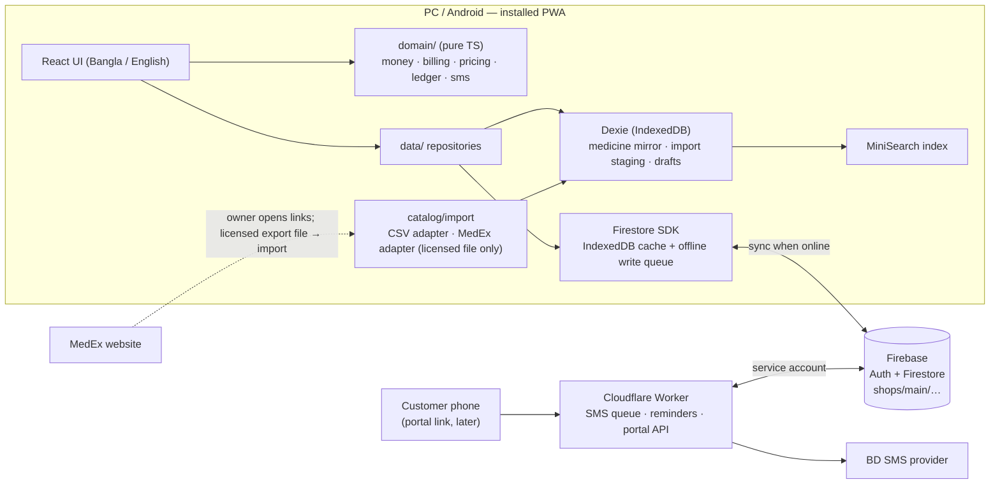

# Architecture — Pharmacy Baki Khata

Status: **Approved by the owner on 2026-10-22** (go-ahead to build). Phase 1 done. Open decisions: see the end of this file.
Shop: M/S ALLOPATHIC STORE & SURGICAL, R.K Mission Road, Sreemangal, 01711460114.
Main purpose: customer due (বাকি) management. Private, non-commercial software.

This document replaces the earlier medicine plan (Kaggle CSV as the medicine database). Kaggle is **not used**.

---

## 0. MedEx findings (checked 2026-10-22)

What was checked: `robots.txt`, Terms of Use, Disclaimer, Downloads page, App page, and one brand page, by normal browser-style requests (no login, no automation beyond reading those pages).

| Question | Finding |
|---|---|
| Official public API? | **None found.** No API docs, no developer page. Their mobile app ("MedEx Plus") talks to private endpoints; we do not use them. |
| Data export / download? | **None for medicines.** The Downloads page has only PDFs (drug acts, formularies, policy documents). |
| robots.txt | `User-agent: * / Disallow:` (technically allows crawling). |
| Terms of Use | §1: view/print/download for **personal, non-commercial use only**; reproduction or distribution without approval prohibited. §2: **extracting data with bots, crawlers or any software without express written consent is prohibited.** |
| CAPTCHA / login on brand pages | None seen. |
| Brand page content | Server-rendered HTML, no structured data. Shows brand, dosage form, generic, strength, manufacturer, unit price, pack (e.g. `2 x 10: ৳ 640.00`), strip price. |

**Conclusion:** robots.txt does not override the Terms of Use. Automated scraping of MedEx is **not appropriate** without written permission. The Kaggle dataset is itself a MedEx scrape, so it has the same problem (and is stale).

**Owner-supplied file (2026-10-22):** `MedEx_Medicine_Directory.xlsx` — generated by a Python script (openpyxl) minutes before it was shared; sheets mirror MedEx's site sections (25,576 allopathic + 930 herbal brands, generics, companies), every row carries a MedEx ID and page link; **no prices, no pack sizes**. It looks like an automated extraction of MedEx, not an official export, so it is **not imported** until the owner confirms written permission from MedEx.
**Update (2026-10-22):** the owner stated that they **have MedEx's written permission** to use this list in the shop's app. The file is therefore imported as a **reference list** (§3.1 `refCatalog`); every upload records the owner's confirmation (`permissionConfirmed` + audit log). Keep a copy of the permission letter with the shop's papers. We still never crawl MedEx or call its endpoints — only this owner-supplied file is used.

So MedEx is treated as a **human reference** (the owner can open a medicine's MedEx page from the app via a saved link) and as a **licensed import source only if MedEx gives written permission or an export file**. The importer is built so that any legitimate file plugs in without changing the rest of the app.

Other legitimate sources the importer supports:
- Supplier/company price lists and purchase invoices the shop already receives (CSV typed or exported by the owner).
- Manual entry from the medicine box (MRP) at the counter.
- (Later, optional) The DGDA registered-drug registry that DGHS publishes as a FHIR code system (~39k products, names/strength/form/manufacturer, **no prices**). Licence/terms to be confirmed before use.

---

## 1. Recommended architecture

Keep the stack already chosen in `CLAUDE.md`, with one addition (Dexie for the local medicine store). No custom backend server.

| Layer | Choice | Why |
|---|---|---|
| App | Vite + React 18 + TypeScript (strict) + Tailwind, installed as a **PWA** on PC and Android | One codebase for PC + mobile; works offline; free hosting |
| Business logic | Plain TypeScript in `web/src/domain/` (no React, no Firebase) | Money and ledger rules are unit-tested in isolation |
| Sync database | **Firebase Firestore** (Spark free plan) with `persistentLocalCache` (IndexedDB) | Built-in offline write queue + multi-device sync; no server to run |
| Auth | Firebase Auth, email/password, one owner | Simple; ready for staff accounts later |
| Local store | **Dexie (IndexedDB)** for the medicine catalog mirror, import staging, drafts, usage counts | Fast offline search over medicines without re-reading Firestore; Firestore's own cache is not searchable |
| Search | MiniSearch (prefix + fuzzy) built from the Dexie medicine table | < 100 ms on a low-end phone |
| Server jobs | **Cloudflare Worker** (free) | SMS sending (API key stays secret), reminder cron, later the customer portal API. Firebase Functions would force the paid Blaze plan |
| Hosting | Firebase Hosting | Free, HTTPS, same project |



**Hard rules**
1. The app never calls MedEx (or any medicine source) during a sale. Sales read only the local medicine store.
2. Every sale line stores a full **snapshot**; old transactions are never recalculated from master data.
3. Money is integer **paisa** everywhere.
4. Customer balance changes only via `increment()` in the same batch as the transaction that causes it.
5. Nothing financial is ever hard-deleted (void + reversal + audit log).

---

## 2. Folder structure

```
pharmacy-baki/
  CLAUDE.md                     # rules for Claude (short; points here)
  docs/
    ARCHITECTURE.md             # this file (source of truth for design)
    SPEC.md                     # screens and behaviour
    PROMPTS.md                  # phase-by-phase build prompts
  data/
    imports/                    # owner's import files (gitignored): supplier lists, licensed exports
  scripts/                      # optional Node helpers (e.g. big-file import dry run)
  web/                          # the PWA
    src/
      app/                      # shell, routes, layout, providers
      domain/                   # PURE logic, 100% unit-tested, no imports from React/Firebase
        types.ts                #   entity types (mirror of §3)
        money.ts                #   paisa parse/format, percent (basis points), rounding
        billing.ts              #   buildSale(), buildPayment(), buildOpening(), buildVoid()
        pricing.ts              #   sellable units (piece/strip/pack/custom), effective price
        ledger.ts               #   running balance, balance check
        phone.ts, sms.ts, dates.ts, ids.ts
      data/
        firebase.ts             #   init, persistent cache, emulator switch
        paths.ts                #   every Firestore path in one place (shops/{shopId}/…)
        localdb.ts              #   Dexie schema + migrations
        repos/                  #   customers, transactions, medicines, settings, smsQueue, audit
      catalog/                  # medicine master-data
        sync.ts                 #   Firestore → Dexie delta sync
        search.ts               #   MiniSearch index + usage ranking
        import/
          pipeline.ts           #   normalize → validate → match → diff → apply
          normalize.ts          #   "2 x 10" → strip 10 / pack 20, "Tab." → "Tablet", price text → paisa
          adapters/
            types.ts            #   SourceAdapter + SourceRecord interfaces
            csv.ts              #   generic CSV (template we publish)
            medex.ts            #   stub; written only against a real licensed sample
      features/                 # screens: dashboard, customers, sale, payment, ledger, reminders,
                                #          reports, medicines, imports, sms-log, settings
      components/  stores/  i18n/
  worker/                       # Cloudflare Worker: /sms/*, cron, /portal/* (later)
  firebase.json  firestore.rules  firestore.indexes.json  .firebaserc
```

Dependency direction: `features → stores/catalog → data → domain`. `domain` imports nothing from the app.

---

## 3. Database / schema structure

### 3.1 Firestore (synced; everything under `shops/{shopId}/`, v1 `shopId = "main"`)

Every document has `schemaVersion: 1`, `createdAt`, `createdBy` (uid), and where editable `updatedAt` (serverTimestamp).

**`settings/general`** — shop info, SMS, reminder, billing, UI settings (unchanged from SPEC §8, §9, §12).

**`customers/{mobile}`** — doc id = normalized mobile `01XXXXXXXXX` (natural de-duplication offline)
```
mobile, name, address, note,
totalDuePaisa            // increment-only
smsEnabled, reminderEnabled, archived,
lastTxnAt, lastPaymentAt, lastReminderAt, reminderMonth, reminderCountThisMonth
```

**`transactions/{autoId}`** — append-only; amounts never edited
```
customerId, customerName            // name snapshot for memos
type: 'sale' | 'payment' | 'opening' | 'adjustment'
memoNo                              // 'B-YYMMDD-XXXX', random suffix (offline-safe)
mode: 'items' | 'amount' | null     // sale only
lines: SaleLine[]                   // sale + items only (see below)
subtotalPaisa
billDiscount: { type: 'none' | 'percent' | 'flat', value }   // percent in basis points (12.5% = 1250)
billDiscountPaisa, roundOffPaisa, netPaisa
paidNowPaisa, paymentMethod: 'cash' | 'card' | 'bkash' | 'nagad' | null, trxId
effectPaisa                         // signed change to totalDuePaisa
memoPrevDuePaisa                    // what the memo showed as "আগের বাকি" (display only, not authoritative)
note, deviceId, serverAt
voided, voidedAt, voidedBy, voidReason
```

**SaleLine (snapshot — copied at sale time, never re-read from master)**
```
lineNo
medicineId: string | null           // link only; null for free-text items
name, genericName, strength, dosageForm, manufacturer
unit: 'piece' | 'strip' | 'pack' | 'custom'
unitLabel: string | null           // custom unit text only ("১ রোল"); null for piece/strip/pack (label shown from unit + piecesPerUnit in the current language)
piecesPerUnit: number | null        // 1, strip size, pack size, or null for custom
qty                                 // positive integer
listUnitPricePaisa: number | null   // master price for this unit at sale time (audit)
unitPricePaisa                      // price actually charged per unit
priceOverridden: boolean
discountPaisa                       // line discount, default 0
lineTotalPaisa                      // qty × unitPricePaisa − discountPaisa
```

**`medicines/{autoId}`** — the shop's own medicine master (only medicines the shop sells; hundreds to a few thousand)
```
brandName, genericName, strength, dosageForm, manufacturer
dosageText                          // form/dosage text exactly as the source wrote it
packDescription                     // e.g. "10 x 10", "100 ml bottle"
piecesPerStrip: number | null
piecesPerPack: number | null
// prices per sellable unit, two layers
sourceUnitPricePaisa, sourceStripPricePaisa, sourcePackPricePaisa   // from the last import/source (nullable)
shopUnitPricePaisa,   shopStripPricePaisa,   shopPackPricePaisa     // owner overrides (nullable) — imports never touch these
// provenance
sourceName: 'manual' | 'csv' | 'medex' | 'dgda'
sourceId: string | null             // e.g. MedEx brand id
sourceUrl: string | null            // link the owner can open
sourceUpdatedAt: Timestamp | null   // date the source says the data is from
sourceFetchedAt: Timestamp | null   // when we imported it
lastImportId: string | null
sourceStatus: 'listed' | 'missing'  // 'missing' = not in the latest import file (flag only)
status: 'active' | 'inactive'       // owner-controlled; never deleted
updatedAt                           // serverTimestamp = "local updated date", drives delta sync
```

**`medicinePriceHistory/{autoId}`** — create-only log: `medicineId, field, oldPaisa, newPaisa, reason: 'import' | 'manual', importId, at, by`

**`medicineImports/{autoId}`** — one summary per import: `sourceName, fileName, fileSha256, sourceDate, counts {new, changed, unchanged, missing, skipped, errors}, status, startedAt, appliedAt, by`. Raw rows are **not** stored in Firestore.

**`smsQueue/{autoId}`**, **`auditLog/{autoId}`** (create-only) — as in SPEC §8 and CLAUDE.md.

**`refCatalog/medex`** + **`refCatalog/medex/chunks/{version}-{n}`** — the MedEx reference list (26,506 brands; no prices), packed into ~4 documents: a dictionary chunk (forms, generics, companies) and row chunks of < 700 KB (`[id, brand, formIdx, strength, genericIdx, companyIdx, slug, herbal]`). The meta doc holds `version` (file SHA-256 prefix), file name/date, counts, `importedAt/By`, `permissionConfirmed`. Uploaded in one batch (atomic); old-version chunks are deleted in the same batch. Never one document per row (free-tier quota).

**Reserved for later (names fixed now, not built):**
`members/{uid}` (role: owner/staff) · `portalLinks/{tokenSha256}` (customer portal) · `stockBatches/{id}`, `stockMovements/{id}` (stock).

**Removed from the old plan:** `medicineOverrides`, `customMedicines` → merged into `medicines` (shop overrides + `sourceName: 'manual'`).

**Indexes:** transactions `(customerId ASC, createdAt DESC)`, transactions `(createdAt DESC)`, smsQueue `(status ASC, createdAt ASC)`, medicines `(updatedAt ASC)`.

### 3.2 Device-local only (Dexie DB `baki-local`, never synced)

| Table | Purpose |
|---|---|
| `medicines` | Mirror of Firestore `medicines` (search source, works offline) |
| `meta` | `medicinesSyncCursor`, local schema version |
| `medicineUsage` | `medicineId → {count, lastUsedAt}` to rank frequent items first |
| `importStaging` | Parsed rows of an import being reviewed |
| `drafts` | Unsaved bill, quick-grid opening import |
| `refCatalog` | Device copy of the MedEx reference list (downloaded from the chunk docs once per version); searched offline, index built on first use; picking an item copies it into `medicines` with `sourceName: 'medex'`, `sourceId`, `sourceUrl` |

---

## 4. Offline data strategy

| Data | Where it lives offline | How it syncs |
|---|---|---|
| App shell, fonts, icons | Service worker precache | New version prompt |
| Customers, settings | Firestore IndexedDB cache | Realtime listener |
| Transactions | Firestore IndexedDB cache | On-demand queries (per customer / date range), paginated |
| Medicines | Dexie mirror (+ Firestore cache) | Delta sync: `where('updatedAt', '>', cursor)` on app start, on reconnect, and after imports. Local edits are written to Firestore **and** Dexie at the same time |
| MedEx reference list | Dexie `refCatalog` | Meta doc checked after each medicine sync (1 read); chunks downloaded only when the version changes (~4 reads) |
| Drafts, staging, usage | Dexie only | Not synced |

- **Writes work offline.** Every save is one `writeBatch`, committed fire-and-forget (never `await commit()` in UI; it only resolves on server ack). The header shows pending-sync count.
- **IDs are created on the device** (Firestore auto-ids, mobile as customer id, random memo suffix) — no counters, no server round-trip.
- **Conflicts:** transactions are append-only (no conflicts); balances use `increment()` (two devices offline both apply correctly); profile/medicine edits are last-write-wins and logged.
- **Free-tier budget** (50k reads / 20k writes per day): medicines are read by delta only; full reference catalogs never go into Firestore; transactions are never listened to in full.
- **Backup:** JSON export of all shop data (Settings → Backup) + weekly reminder.

**Implementation notes (Phase 2):**
- New customers are written with `set(…, {merge: true})` and `totalDuePaisa: increment(0)`: the field exists from the start, and a second device creating the same mobile offline can never overwrite a due.
- The customers listener covers archived customers too (few; the list filters them) and runs with metadata changes, so the header's pending count = max(in-flight batches, customer docs with `hasPendingWrites`) and survives reloads.
- `settings/general` is bootstrapped with defaults only when the **server** (not the cache) says it is missing.
- Rules stay loose on customer updates (only `mobile` is frozen), because a rejected offline batch would silently drop its transaction.
- Aging falls back to the customer's `createdAt` when there was never a payment (no extra field needed).

---

## 5. Medicine master-data strategy

Two layers, one record:

1. **Source layer** (`source*` fields) — what the last import/source said. Updated only by the import pipeline.
2. **Shop layer** (`shop*` price fields, `status`, `piecesPerStrip/Pack` edits) — what the owner decided. Imports never overwrite it.

**Effective price** for a chosen unit = shop override → source price for that unit → derived (`piece price × pieces per unit`). Price edits in the sale screen can be saved back as a shop override (asks first) and are logged in `medicinePriceHistory`.

**Sellable units** come from the record: `piece` always; `strip` if `piecesPerStrip`; `pack` if `piecesPerPack`; `custom` always (free label + price). Quantity is a positive integer of the chosen unit.

**Adding medicines (v1, works today):**
- Quick add from the sale screen when search finds nothing (brand, strength, form, company, price, strip/pack size; optional MedEx link).
- Medicines screen: list, edit, deactivate, price history.
- CSV import (template provided) for supplier price lists the shop owns.

**History safety:** changing or deactivating a medicine never touches `transactions`; sale lines carry their own snapshot.

**Implementation notes (Phase 3):**
- Prices typed by the owner (quick add / edit) are stored as `shop*` prices; `source*` stays empty for manual entries. Every shop price change appends `medicinePriceHistory`.
- Dexie DB is named per Firebase project (`baki-local-<projectId>`), so emulator test data never mixes with the real shop.
- Delta sync: `updatedAt >= cursor − 60 s`, ordered, 500 per page, server only; runs on sign-in, on reconnect, when the app returns to the front (≥ 60 s gap), from the সিঙ্ক button, and retries itself after a failure (15 s, 30 s … 5 min).
- Search speed (MacBook, MiniSearch): 5,000 medicines → index 32 ms, slowest query < 2 ms; ~200 sample medicines in the browser → 0.4–4 ms including render. No Web Worker needed at shop scale.
- Header pending count also covers writes queued before a reload in any collection (`waitForPendingWrites`).

---

## 6. MedEx synchronization strategy

"Sync" means **owner-triggered re-import of a legitimate file**, never live calls and never scraping.

```
file (CSV / JSON / licensed MedEx export)
  → SourceAdapter.parse()          // one adapter per source format
  → normalize                      // trim, unify forms, "2 x 10" → strip 10 / pack 20, price → paisa
  → validate                       // errors block a row; warnings shown
  → match                          // 1) sourceName+sourceId  2) brand|strength|form|manufacturer  3) ambiguous → owner picks
  → diff                           // new · changed (field by field) · unchanged · missing from file
  → review screen                  // owner ticks/unticks rows, sees old → new prices
  → apply (batches ≤ 400 ops)      // update source* fields only, append price history, write medicineImports, audit log
```

```ts
interface SourceRecord {
  sourceName: string; sourceId?: string; sourceUrl?: string;
  brandName: string; genericName?: string; strength?: string; dosageForm?: string; manufacturer?: string;
  dosageText?: string; packDescription?: string; piecesPerStrip?: number; piecesPerPack?: number;
  unitPricePaisa?: number; stripPricePaisa?: number; packPricePaisa?: number;
  sourceUpdatedAt?: string; raw: Record<string, string>;
}
interface SourceAdapter { id: string; label: string; parse(file: File): Promise<SourceRecord[]> }
```

Rules:
- Imports never delete; records missing from a new file get `sourceStatus: 'missing'` only.
- Imports never change shop overrides or `status`.
- The same file twice = zero changes (idempotent; file SHA-256 stored).
- **MedEx adapter** (done, owner confirmed permission): reads the owner's `.xlsx` in the browser (built-in ZIP reader + `DecompressionStream`, no library), uses every sheet whose header has `ID, Brand Name, Dosage Form, Strength, Generic Name, Company, MedEx Link` (sheets named *herbal* are flagged), validates each link against its id, and stores the list as the reference catalog. Because the file has no prices, rows are not pushed into the shop list in bulk; the owner adds each medicine the shop sells (with price) from search.
- If MedEx ever offers an official API/feed with permission, a `medex-api` adapter runs in the Worker (server-side key, rate-limited) and produces the same `SourceRecord`s into the same review step.
- If MedEx is down or unavailable: nothing changes for the shop. All selling uses the local master.

---

## 7. Financial calculation strategy

All in `web/src/domain/`, pure functions, unit-tested (including property tests: Σ non-voided `effectPaisa` = `totalDuePaisa`).

| Step | Rule |
|---|---|
| Storage | Integer paisa (`number`, safe far beyond any shop total). No floats stored or summed. |
| Input | Accept `1,250.50` and Bangla digits; max 2 decimals; reject negatives. |
| Line | `gross = qty × unitPricePaisa`; `0 ≤ discountPaisa ≤ gross`; `lineTotal = gross − discount` |
| Subtotal | `Σ lineTotal` (amount mode: the typed amount) |
| Bill discount | Percent stored as basis points: `round_half_up(subtotal × bp / 10000)`; flat `≤ subtotal` |
| Round-off | If enabled: net to nearest taka (half up); `roundOffPaisa` stored as its own line (−49…+50) |
| Paid now | `0 ≤ paidNow ≤ net` (extra money = a separate payment) |
| Effect | sale `net − paidNow` · payment `−amount` · opening `+amount` · adjustment `±amount` (reason required) |
| Balance | `totalDuePaisa` only via `increment(effect)` in the same batch. Negative = advance (অগ্রিম). |
| Correction | Void = mark voided + `increment(−effect)` + audit. Never edit amounts. |
| Ledger | Running balance computed on screen; "Balance check" tool recomputes and repairs with `increment(diff)` + audit. |
| Reports | From transactions, `Asia/Dhaka` day boundaries; collections by method include `paidNow` on sales. |

---

**Implementation notes (Phase 4 — New Baki):**
- The bill being typed is a text-based draft (`domain/saleDraft.ts`): live totals and per-line errors come from `evaluateDraft()`; `draftToSale()` builds the snapshot transaction at save time. The draft is autosaved to Dexie (`drafts`), so a closed tab never loses a bill.
- Save = one batch: transaction + `increment(totalDuePaisa)` + `lastTxnAt` (+ `lastPaymentAt` when money was paid now). Not awaited; works offline.
- A new customer typed on the sale screen is created first (its own small batch) and the bill follows; both queue in order offline.
- Memo numbers and mobile numbers are shown in English digits (easier to match on paper); amounts follow the Bangla/English digit setting.
- Same medicine + unit added again increases the quantity instead of adding a row. An edited price can be kept as the shop price for that unit (logged in price history).

**Implementation notes (Phase 5 — payment, ledger, void, balance check):**
- Payment = `buildPayment()` + the same one-batch save (`effect = −amount`, `lastPaymentAt`). Paying more than the due asks once and leaves an advance (negative due).
- Ledger reads newest first, 30 per page: the first page is a live listener (new sales/voids show at once, also offline), older pages load on demand. Running balance is walked back from the customer's current due (`balancesFromNewest`).
- Void = one batch: `voided/voidedAt/voidedBy/voidReason` + `increment(−effect)` + audit. Voiding a sale cancels the whole bill, including any money marked "paid now" on it; if that money was really received, record it as a payment.
- ব্যালেন্স যাচাই reads every transaction from the server (500 per page), compares Σ non-voided effects with each stored due, and repairs only with `increment(diff)` + an audit entry. It needs internet by design.

## 8. SMS integration strategy

- **Only the Worker sends SMS** (API key never in the browser).
- App writes an `smsQueue` doc in the **same batch** as the sale/payment → calls Worker `POST /sms/process` when online → Worker claims each item with an `updateTime` precondition (no double send) → provider → `sent` / `failed`.
- Offline saves sync later; a Worker cron sweeps old `pending` items and retries `failed` (max 3).
- **Test mode on by default** (status `test`, nothing sent) until the provider is verified.
- Provider adapter interface `{ send(to, text, unicode), balance?() }`; implemented only from the provider's real API docs.
- Provider must support Bangla Unicode, HTTP API, **no mandatory IP whitelist** (Worker IPs change). Start with non-masking.
- Templates in Bangla with a live segment counter (Unicode 70 / 67 per part) and cost estimate.
- Per-customer SMS on/off; reminders by daily cron with the rules in SPEC §9.

---

## 9. Customer portal strategy (later phase, design fixed now)

- Customers **never** get a login into the shop's Firestore.
- Owner taps "পোর্টাল লিংক পাঠাও" → app creates a random 128-bit token; Firestore stores only its SHA-256 in `portalLinks/{hash}` with `customerId, createdAt, expiresAt, revoked`.
- Link is sent by SMS: `https://<app-domain>/p/<token>`.
- A tiny public page calls Worker `GET /portal/<token>` → Worker checks hash, expiry, rate limit → returns only that customer's current due and recent transactions (no notes, no other customers).
- Owner can revoke any time. Optional SMS OTP later. Stays on the free plans.

---

## 10. Development phases

| # | Phase | Notes |
|---|---|---|
| 0 | Setup (owner) | Node, Firebase CLI, Firebase project, Auth user. **No Kaggle download.** |
| 1 | Skeleton + domain core | PWA shell, i18n, `domain/` (money, billing, pricing, ledger, phone, sms, dates, ids) with tests |
| 2 | Firebase + login + customers | rules + rules tests, settings bootstrap, customer lookup/list/detail |
| 3 | Medicine master | Firestore `medicines` + Dexie mirror + delta sync + search + quick add/edit + price history |
| 4 | Sale (নতুন বাকি) | units piece/strip/pack/custom, custom price, line + bill discount, snapshots |
| 5 | Payment, ledger, void, audit, balance check | |
| 6 | Imports | opening-balance CSV; medicine CSV import pipeline + review screen; MedEx adapter only if a licensed file exists |
| 7 | SMS | Worker + queue + templates + log |
| 8 | Reminders (তাগাদা) | cron + page |
| 9 | Dashboard + reports | |
| 10 | PNG memo / statement / share | |
| 11 | PIN lock, backup/restore, settings | |
| 12 | QA + deploy + Banglish runbook | |
| later | Customer portal · staff accounts (`members`, custom claims) · stock (`stockBatches`, `stockMovements`; sale lines already carry `medicineId` + `piecesPerUnit × qty`) | |

Each phase: plan → implement → tests + build → owner checks → next phase.

---

## Open decisions (owner)

1. MedEx written permission — ask or not (until then: manual entry + supplier CSV).
2. SMS provider — choose before Phase 7.
3. DGDA registry as optional reference — later, after licence check.
